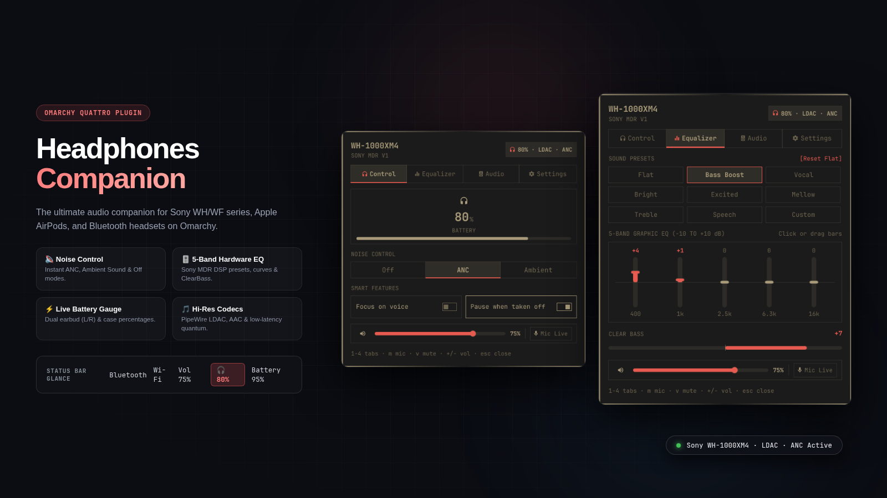
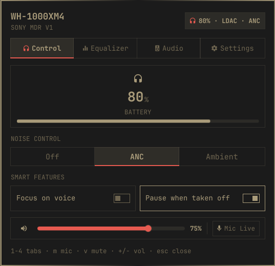
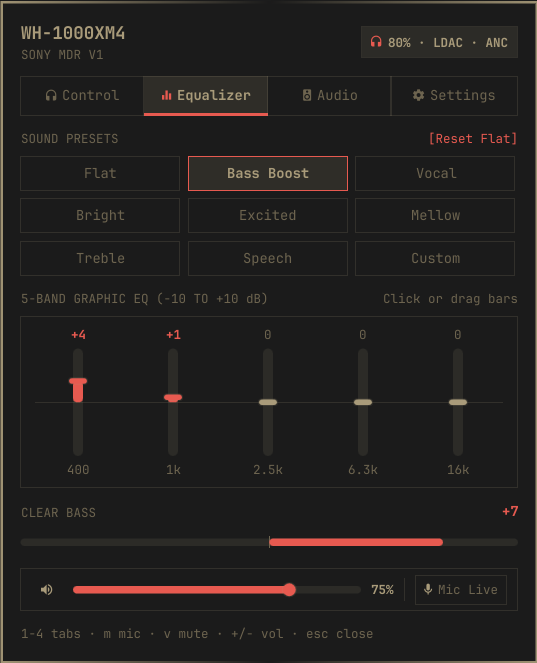
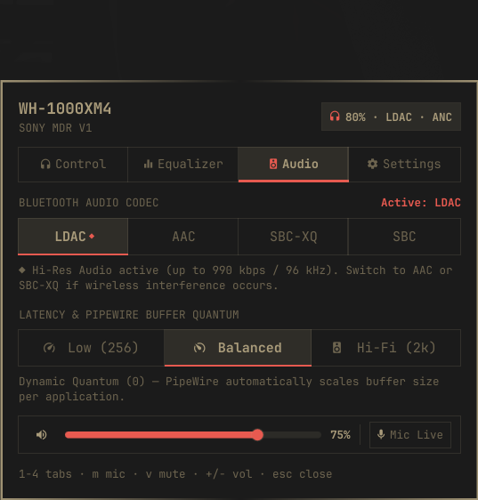
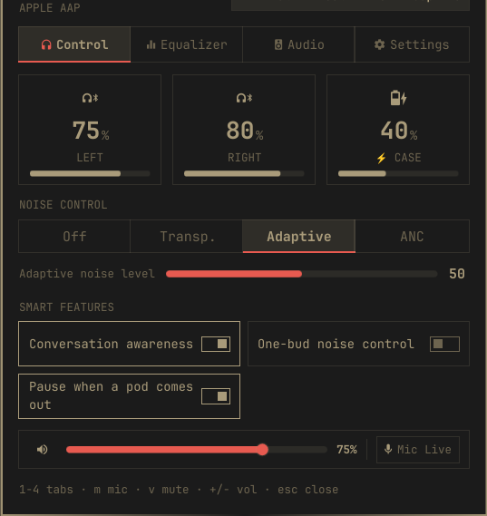

# Headphones Companion (`eh0.headphones`)

<div align="center">



[](https://omarchy.org)
[](https://github.com/hes0s/omarchy-headphones/releases/tag/v1.0.1)
[](https://pipewire.org)
[](LICENSE)

**A unified native bar widget and audio control panel for Bluetooth headphones on Omarchy.**

[Installation](#installation) • [Features](#features) • [Screenshots](#screenshots) • [Configuration](#configuration) • [Keyboard Shortcuts](#keyboard-shortcuts)

</div>

---

## Overview

**Headphones Companion** brings deep hardware integration for wireless headsets into the Omarchy shell. It delivers precision battery telemetry, segmented active noise cancellation (ANC), native hardware DSP equalizer presets, and seamless PipeWire codec switching right from your status bar.

Engineered with dedicated hardware protocols:
- **Sony WH/WF Series**: Full Sony MDR v1 protocol support for hardware ANC, Ambient Sound level sliders, 5-band graphic DSP EQ registers, and ClearBass.
- **Apple AirPods**: Native Bluetooth Low Energy (BLE) telemetry for independent Left, Right, and Case battery levels, adaptive noise modes, and conversation awareness.
- **Universal Bluetooth Audio**: BlueZ battery reporting, PipeWire high-resolution codec negotiation (LDAC, AAC, aptX, aptX HD, SBC-XQ), latency profiles, and docked output/mic audio controls.

---

## Screenshots

<div align="center">

| Active Noise Control & Smart Features | 5-Band Graphic Hardware Equalizer |
| :---: | :---: |
|  |  |
| *Segmented ANC, Ambient level & wear detection* | *DSP EQ sliders, ClearBass & sound presets* |

| PipeWire Codec & Latency Switcher | Apple AirPods Dual-Bud Telemetry |
| :---: | :---: |
|  |  |
| *Hi-Res LDAC, AAC & PipeWire buffer quanta* | *Independent Left, Right & Case battery levels* |

</div>

<div align="center">

### Status Bar Integration

*Compact theme-aware battery pill and noise mode badge right in the Omarchy Quattro bar.*

</div>

---

## Features

### 🔇 Segmented Active Noise Control
- Instantly switch between **Off**, **Active Noise Cancellation (ANC)**, and **Ambient Sound**.
- Smooth awareness level adjustment (1–20) for Sony headsets and adaptive noise sliders for AirPods.
- Focus-on-voice toggle for transparent conversations without removing your headset.

### ⚡ Precision Battery Telemetry
- **Single Battery View**: Instant percentage gauge for over-ear headphones (e.g. Sony WH-1000XM4, Bose, JBL).
- **True Wireless Stereo (TWS)**: Independent Left earbud, Right earbud, and Charging Case battery monitoring with active charging indicators.
- **Visual Warnings**: Configurable low-battery color highlights on the bar widget and desktop alerts when dropping below threshold.

### 🎚️ 5-Band Hardware Equalizer & DSP Presets
- Direct hardware DSP synchronization: changes are written straight to headphone onboard registers.
- 5-band frequency adjustment (-10 dB to +10 dB) across 400 Hz, 1 kHz, 2.5 kHz, 6.3 kHz, and 16 kHz.
- Dedicated **ClearBass** hardware slider (-10 to +10).
- Instant sound presets: *Flat*, *Bass Boost*, *Vocal*, *Bright*, *Excited*, *Mellow*, *Treble*, *Speech*, and *Custom*.

### 🎵 PipeWire Codec & Latency Switcher
- One-click Bluetooth codec switching directly through PipeWire:
  - **LDAC**: Hi-Res Audio streaming (up to 990 kbps / 96 kHz).
  - **AAC & SBC-XQ**: High-stability low-jitter balanced wireless audio.
  - **aptX & aptX HD**: High-definition Bluetooth playback.
  - **SBC**: Standard fallback compatibility.
- Instant PipeWire buffer quantum presets:
  - **Low Latency (256)**: Real-time gaming, video editing, and monitoring.
  - **Balanced**: Standard dynamic buffer management.
  - **Hi-Fi (2048)**: Maximum stability against packet dropouts.

### 🎙️ Docked Audio & Microphone Control Strip
- Docked at the bottom of the panel across all tabs for frictionless access.
- Interactive volume slider with smooth dragging and scroll-wheel step adjustments (`±5%`).
- Single-click microphone mute toggle with live state indication (`Mic Live` / `Mic Muted`).

### 🧠 Smart Automation & Wear Detection
- **Auto-Pause on Removal**: Automatically pauses MPRIS media playback when taking off headphones or removing an earbud.
- **Fast Pair Advertisement**: Google Fast Pair BLE broadcast support for fast device pairing.

---

## Keyboard Shortcuts

The control panel features full keyboard accessibility:

| Key | Action |
|:---:|---|
| `1` – `4` | Switch between tabs (*Control*, *Equalizer*, *Audio*, *Settings*) |
| `m` | Toggle microphone mute |
| `v` | Toggle audio output mute |
| `+` / `-` | Increase / decrease volume by 5% |
| `Esc` | Close panel |

---

## Requirements

Headphones Companion relies on standard modern Linux audio and Bluetooth services:

- **Omarchy Shell** / **Quickshell**
- **PipeWire** & `wireplumber` (for audio routing and Bluetooth codec negotiation)
- **BlueZ** (for Bluetooth device discovery and battery reporting)
- **Python 3** & `python3-dbus` (included on Omarchy / Arch Linux)

---

## Installation

### From Marketplace
```bash
omarchy plugin add eh0.headphones --enable
```

### Direct via Git
```bash
omarchy plugin add https://github.com/hes0s/omarchy-headphones.git --enable
```

After installation, reload the Omarchy shell:
```bash
omarchy-restart-shell
```

---

## Configuration

Settings can be customized directly in the panel's **Settings** tab, via Omarchy Bar Settings, or in `shell.json`:

| Key | Type | Default | Description |
|---|---|---|---|
| `showBattery` | enum (`true`/`false`) | `true` | Display battery percentage number directly on the bar |
| `hideWhenDisconnected` | enum (`true`/`false`) | `true` | Hide the bar widget when no headphones are connected |
| `lowThreshold` | integer (5–40) | `15` | Battery level threshold (%) for low battery warning highlight |
| `notifyLow` | enum (`true`/`false`) | `true` | Send system notification when battery drops below threshold |
| `earBehavior` | enum | `One out` | Behavior when removing an earbud (`One out`, `Both out`, `Never`) |

---

## Removal

To disable and remove the plugin cleanly:
```bash
omarchy plugin remove eh0.headphones
```

---

## License

This project is licensed under the [MIT License](LICENSE).
